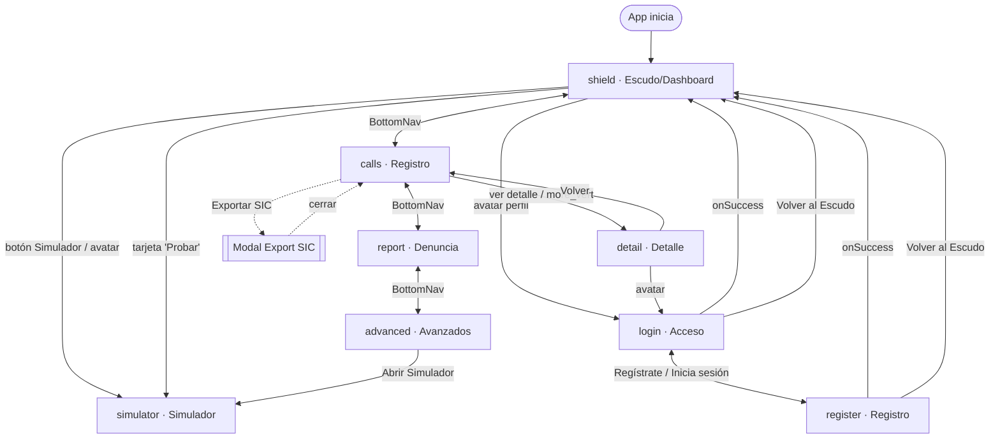

# 3. Mapa de navegación

## Mecanismo

No hay router ni URLs. La navegación es un **estado único** `activeScreen` en `App.tsx` cambiado por `setActiveScreen`. Cada pantalla recibe callbacks (`onNavigate`, `onBack`, `onSuccess`, etc.) que terminan llamando a `setActiveScreen`. No hay historial de navegación (back del navegador/OS no funciona como "atrás" dentro de la app) ni deep links.

Puntos de entrada a la navegación:
- `BottomNav` → `shield`, `calls`, `report`, `advanced`.
- `Header` → `simulator` (botón), `login` (avatar), `shield` (volver en auth/detail).
- Botones internos de cada pantalla.
- Toolbar superior de demo (puede saltar a cualquier pantalla, incluido `detail` con fallback a `INITIAL_EVENTS[0]`).

## Diagrama de flujo

## Tabla de transiciones

| Origen | Disparador | Destino |
|--------|-----------|---------|
| `shield` | BottomNav | `calls`, `report`, `advanced` |
| `shield` | Tarjeta "Probar" / botón Header "Simulador" | `simulator` |
| `shield` | Avatar en Header | `login` |
| `calls` | "Ver detalles" / `more_vert` sobre evento | `detail` |
| `calls` | "Exportar SIC" (solo eventos "Ley…") | abre **modal** (no cambia pantalla) |
| `detail` | "Volver" (Header o botón) | `calls` |
| `detail` | Avatar en Header | `login` |
| `report` | BottomNav | `shield`, `calls`, `advanced` |
| `simulator` | BottomNav | `shield`, `calls`, `report`, `advanced` |
| `advanced` | "Abrir Simulador" | `simulator` |
| `login` | `onSuccess` (tras ~1s) | `shield` |
| `login` | "Regístrate" | `register` |
| `login` | "Volver al Escudo" | `shield` |
| `register` | `onSuccess` (tras ~2.4s) | `shield` |
| `register` | "Inicia sesión" | `login` |
| `register` | "Volver al Escudo" | `shield` |

## Visibilidad de navegación por pantalla

| Pantalla | Header | BottomNav |
|----------|:---:|:---:|
| `shield` | Estándar | ✅ |
| `calls` | Estándar | ✅ |
| `report` | Estándar | ✅ |
| `advanced` | Estándar | ✅ |
| `simulator` | Estándar | ✅ |
| `detail` | Variante detalle | ❌ |
| `login` | Variante auth | ❌ |
| `register` | Variante auth | ❌ |

## Gaps de navegación (para producción)

- **❌ Sin guard de autenticación:** la app abre directamente en `shield`. `login`/`register` son opcionales y `onSuccess` solo regresa a `shield`. No hay sesión, logout ni rutas protegidas.
- **❌ Sin back nativo / historial:** `onBack` de `detail` siempre va a `calls`, aunque se haya llegado desde el toolbar o desde otra pantalla. En Flutter esto debe mapearse a `Navigator.pop` con pila real.
- **❌ Sin deep linking:** no hay URLs; imposible compartir/abrir una pantalla específica. Relevante si en producción se abre desde una notificación push (p. ej. abrir `detail` de un evento).
- **🟡 `detail` sin selección:** si se navega a `detail` sin evento, hay fallback a datos mock. En producción debe manejarse "evento no encontrado".
- **❌ Sin estado de navegación profunda** (p. ej. volver desde `simulator` a la pantalla previa): `simulator` solo se abandona vía BottomNav.
