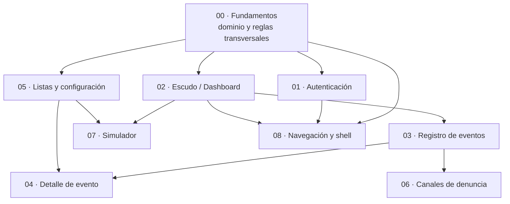

# Especificación funcional por pantalla — Cifrado Cero

Esta carpeta contiene la **especificación funcional de negocio** de la aplicación **Cifrado Cero** (filtro telefónico local "zero-knowledge" para Colombia). Es el insumo para construir la aplicación en Flutter.

A diferencia de `01-docs/` (que es un análisis de ingeniería inversa de **lo que el prototipo hace hoy**), `02-business/` describe **lo que el producto debe hacer**: comportamientos esperados, reglas de negocio, criterios de aceptación y decisiones de diseño que el prototipo deja ambiguas o ausentes.

## Fuente del análisis

- Prototipo React en `app_desing/` (comportamiento observado en el código).
- Documentación de ingeniería inversa en `01-docs/`.

Donde el prototipo no define un comportamiento (errores, estados vacíos, validaciones, permisos, respuestas de servidor), esta especificación **propone** una definición y la marca explícitamente como tal, para que el equipo de producto la confirme.

## Organización por dependencias

Las funcionalidades están divididas en carpetas numeradas. La numeración refleja el **orden de dependencia**: una carpeta de número mayor normalmente depende de conceptos definidos en carpetas de número menor. Se recomienda leerlas y construirlas en este orden.

| # | Carpeta | Pantalla(s) | Depende de |
|---|---------|-------------|------------|
| 00 | [`00-fundamentos`](./00-fundamentos/) | — (transversal) | — |
| 01 | [`01-autenticacion`](./01-autenticacion/) | `login`, `register` | 00 |
| 02 | [`02-escudo-dashboard`](./02-escudo-dashboard/) | `shield` | 00 |
| 03 | [`03-registro-eventos`](./03-registro-eventos/) | `calls` | 00, 02 |
| 04 | [`04-detalle-evento`](./04-detalle-evento/) | `detail` | 00, 03, 05 |
| 05 | [`05-listas-y-configuracion`](./05-listas-y-configuracion/) | `advanced` | 00, 02 |
| 06 | [`06-canales-denuncia`](./06-canales-denuncia/) | `report` | 00, 03 |
| 07 | [`07-simulador`](./07-simulador/) | `simulator` | 00, 02 |
| 08 | [`08-navegacion-y-shell`](./08-navegacion-y-shell/) | Header, BottomNav, shell | 00 y todas |

### Grafo de dependencias

Lectura del grafo:
- **00 Fundamentos** es la raíz: define las entidades (`EventoInterceptado`, `ConfigEscudo`, listas, usuario) y las reglas transversales que el resto reutiliza.
- **02 Escudo** define el estado global de protección del que dependen el registro de eventos (03) y el simulador (07).
- **05 Listas** y **03 Registro** comparten el dominio de números de confianza / lista negra; el **04 Detalle** depende de ambos porque opera sobre un evento y modifica las listas.
- **06 Denuncia** depende del registro de eventos porque la evidencia SIC se construye a partir de un evento.
- **08 Navegación** envuelve a todas y se especifica al final.

## Convenciones de identificadores

| Prefijo | Significado |
|---------|-------------|
| `PANT-XX` | Pantalla |
| `RF-XX`   | Requisito funcional |
| `RN-XX`   | Regla de negocio |
| `CA-XX`   | Criterio de aceptación (formato Dado/Cuando/Entonces) |
| `EST-XX`  | Estado de la pantalla/componente |

## Convención de madurez

Cada comportamiento se etiqueta según su origen:

- **[PROTOTIPO]** — ya existe y funciona (aunque sea simulado) en `app_desing/`.
- **[SIMULADO]** — el prototipo lo finge (`setTimeout`, `Math.random`, data estática); debe implementarse de verdad.
- **[PROPUESTO]** — no existe en el prototipo; esta especificación lo define y **requiere confirmación de negocio**.

> Los puntos marcados **[PROPUESTO]** son decisiones que tomamos ante la ausencia de definición en el prototipo. Están señaladas para que el área de negocio las valide o ajuste.

## Decisiones de negocio confirmadas

Estas decisiones ya están tomadas y aplican a toda la especificación:

- **DN-01 · Habrá backend.** La aplicación de producción se apoya en un backend propio. El contrato de API (autenticación, reputación comunitaria, distribución de firmas, etc.) **se define en el documento de arquitectura del sistema**, no aquí. En esta especificación las operaciones de servidor se dan por existentes y solo se describe su comportamiento esperado desde el punto de vista funcional.
- **DN-02 · El login es obligatorio.** La aplicación **exige una cuenta e inicio de sesión**. No hay modo invitado ni uso anónimo local. La pantalla de arranque es `login` (no el Dashboard), existe un guard de autenticación sobre las pantallas internas y debe existir cierre de sesión. Ver 01-autenticación y 08-navegación.

## Preguntas abiertas de negocio (consolidadas)

Estas preguntas afectan a varias pantallas y conviene resolverlas pronto. Cada documento las repite en su contexto.

1. **Interceptación real de llamadas/SMS:** es el núcleo del producto y hoy no existe. Depende de permisos del SO (CallScreening/CallKit, filtro SMS). ¿Alcance del MVP?
2. **Normalización de números:** ¿se adopta formato E.164 (`+57XXXXXXXXXX`) como canónico para deduplicar listas?
3. **Festivos colombianos:** la regla Ley 2300 bloquea domingos y festivos. ¿De dónde sale el calendario de festivos?
4. **Modelo de recuperación de clave** bajo zero-knowledge (llave de respaldo, frase semilla) y qué ocurre si el usuario la pierde.
