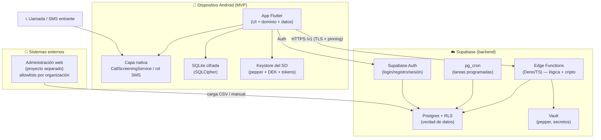
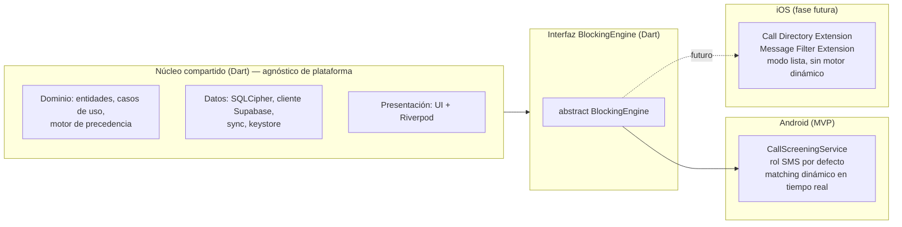
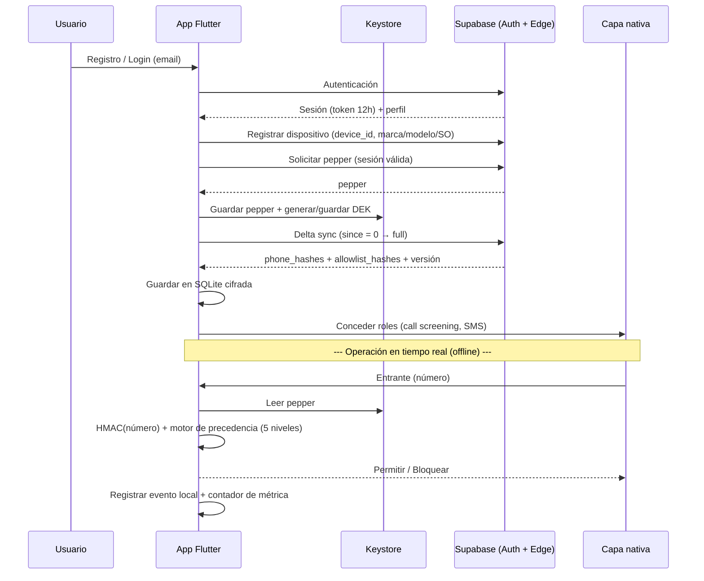

# 01 · Vista de alto nivel y topología

Describe las piezas del sistema, cómo se relacionan y qué responsabilidad tiene cada una. El detalle de cada bloque vive en los documentos siguientes.

---

## 01.1 Diagrama de contexto



El filtrado real ocurre **dentro del dispositivo**: la capa nativa recibe el evento entrante, la app lo evalúa contra las listas locales (hashes descargados + listas del usuario) y decide. El servidor **no participa** en la decisión de bloqueo en tiempo real.

---

## 01.2 Componentes y responsabilidades

### Dispositivo (Android, MVP)

| Componente | Responsabilidad |
|-----------|-----------------|
| **App Flutter** | UI, lógica de dominio (motor de precedencia, estados del escudo), orquestación de sync, cálculo de métricas locales. |
| **Capa nativa (`BlockingEngine`)** | Interceptar llamadas (`CallScreeningService` + rol de call screening) y filtrar SMS (rol de app SMS). Expuesta a Dart vía platform channels. |
| **SQLite cifrada (SQLCipher)** | Persistir: hashes descargados, listas blanca/negra locales, config del escudo, historial de eventos, contadores de métricas locales. |
| **Keystore del SO** | Custodiar el **pepper**, la **DEK** de SQLCipher y los **tokens** de sesión. Respaldado por hardware (TEE/Secure Enclave). |

### Supabase (backend)

| Componente | Responsabilidad |
|-----------|-----------------|
| **Supabase Auth** | Registro, login, sesión, refresh token, recuperación por email. |
| **Edge Functions (Deno/TS)** | Toda la lógica de negocio y criptográfica: HMAC con pepper, delta sync, entrega del pepper, ingesta de reportes, ingesta de métricas, validación de sesión/dispositivo. Única frontera que toca el pepper. |
| **Postgres + RLS** | Verdad de datos: perfiles, dispositivos, hashes, reportes, allowlists, parámetros, métricas agregadas. RLS como línea de defensa de acceso por fila. |
| **pg_cron** | Promoción de reportes que superan umbral, recálculo de `dataset_version`, limpieza/retención. |
| **Vault** | Pepper y demás secretos criptográficos. |

### Externo

| Componente | Responsabilidad |
|-----------|-----------------|
| **Administración web** (fuera de alcance) | Proyecto separado que carga y gestiona las **allowlists por organización** (gobierno, empresas) vía CSV o manual. Este sistema solo **consume** esos datos a través del dataset. |

---

## 01.3 Alcance de plataforma — Android-first [DA-12]



**Regla de oro:** todo lo que no sea interceptación nativa es **compartido** y agnóstico. La interceptación se aísla tras `BlockingEngine` desde el día uno, aunque hoy solo exista la implementación Android. Esto evita reescribir el núcleo cuando entre iOS.

### Diferencias de capacidad por plataforma

| Capacidad | Android (MVP) | iOS (futuro) |
|-----------|:---:|:---:|
| Interceptar llamada en tiempo real y decidir | ✅ `CallScreeningService` | ❌ (solo lista precargada en Call Directory) |
| Motor de capas dinámico en el momento | ✅ | ❌ |
| Filtrar SMS por contenido/remitente | ✅ (rol SMS) | 🟡 solo remitentes desconocidos, sin leer todo |
| Matching HMAC local offline | ✅ | 🟡 lista empujada a la extensión |
| Resto (cuenta, sync, listas, reportes, métricas, UI) | ✅ | ✅ (idéntico, compartido) |

> **Expectativa clara:** no habrá **paridad de interceptación** entre plataformas; sí habrá paridad en todo lo demás. iOS funciona más como "proveedor de listas" que como interceptor activo.

---

## 01.4 Flujo macro: de la instalación al bloqueo



El contacto diario con el servidor (renovación de sesión a 12h + delta sync) mantiene fresca la lista y aplica revocaciones. Entre tanto, el bloqueo opera **100% offline**.

---

## 01.5 Vista de despliegue (monorepo)

```
shield-co-vip/
├── 01-docs/                 # Especificación funcional (existente)
├── 02-business/             # Reglas de negocio por capacidad (existente)
├── 03-architecture/         # Este bloque
├── app_desing/              # Prototipo React de referencia (NO productivo)
├── app/                     # [NUEVO] App Flutter (Android-first)
└── supabase/                # [NUEVO] Migraciones SQL + Edge Functions
    ├── migrations/
    └── functions/
        ├── v1-sync/
        ├── v1-report/
        ├── v1-pepper/
        ├── v1-metrics/
        └── v1-session/
```

El detalle de ramas, versiones y despliegue está en [06 · Entornos, branching y versionado](./06-entornos-branching-versionado.md).
