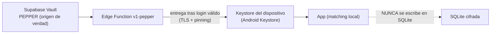
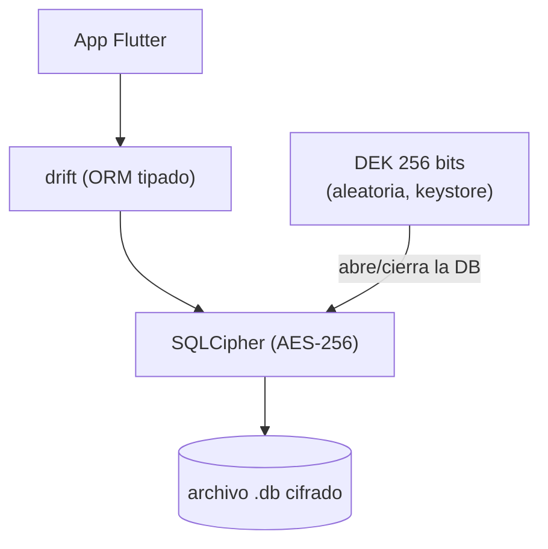
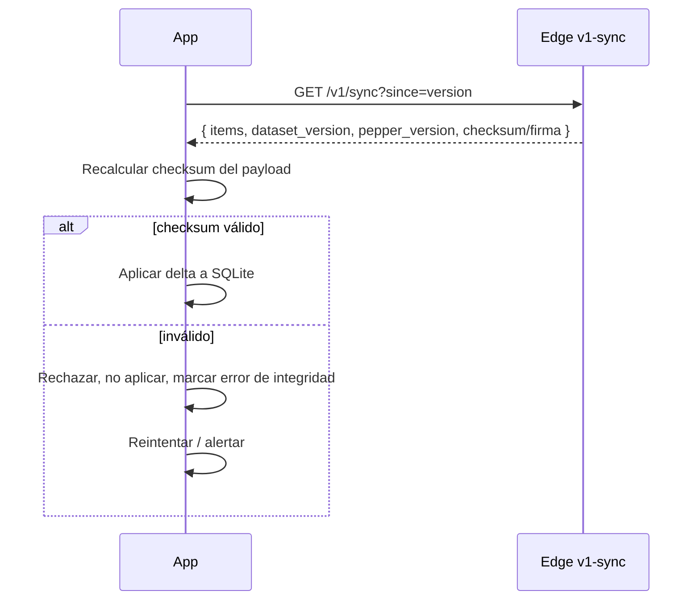

# 02 · Seguridad y criptografía

Documento central de la promesa de marca (RN-01) y del punto "seguridad primordial". Define el modelo Zero-Knowledge, el esquema criptográfico, la custodia de secretos, el cifrado local y el hardening del cliente.

---

## 02.1 Qué significa "Zero-Knowledge" aquí (y qué no)

Es importante ser honestos con el alcance del término para no sobre-prometer.

**Zero-Knowledge SÍ significa, en este sistema:**
- El **historial de quién llama/escribe** al usuario **nunca sale** del dispositivo.
- El **contenido** de los SMS **nunca sale**.
- Las **listas blanca/negra locales** del usuario **nunca se sincronizan**.
- Los **números que te contactan** no son conocidos por el servidor.

**Zero-Knowledge NO significa:**
- Que el servidor no conozca tu **cuenta**. El sistema **sí** conoce tu email y tu **propio** número (para cuenta, futura exclusividad por número y OTP futuro). Esto es un dato que el usuario entrega sobre **sí mismo**, no sobre terceros.
- Cifrado E2E contra el proveedor para la cuenta. La recuperación de clave es estándar vía email.

> **Principio:** la frontera de privacidad separa **"datos de terceros que te contactan"** (nunca salen) de **"tu propia identidad de cuenta"** (vive en el servidor, consentida). Mantener esta distinción clara es lo que hace el modelo sostenible y verificable.

---

## 02.2 Esquema criptográfico de hashes — HMAC + pepper [DA-05]

### El problema

Los móviles colombianos son 10 dígitos que empiezan en 3 → ~10^9 combinaciones. Un atacante que obtenga la lista de hashes puede **precomputar todos los SHA-256 posibles en minutos** y revertir cada hash a su número. Un hash "pelado" **no protege nada**.

### La solución

```
hash_numero = HMAC-SHA-256(key = PEPPER_SECRETO, msg = numero_normalizado)
```

- **`PEPPER_SECRETO`**: clave secreta de alta entropía (≥ 256 bits), generada una sola vez.
- Sin el pepper, el espacio de búsqueda es inatacable por fuerza bruta: el atacante no puede precomputar nada útil.
- **E.164** para móviles (`+57` + 10 dígitos); **códigos cortos SMS** se hashean tal cual, sin normalización E.164, y se marcan como categoría aparte (RN-04).

### Custodia del pepper



- El pepper **vive en Vault** y solo lo lee la Edge Function `v1-pepper`.
- Se entrega al dispositivo **tras autenticarse** y se guarda en **keystore**, nunca en la SQLite ni en logs.
- El dispositivo necesita el pepper para calcular el HMAC del número **entrante** y compararlo con la lista local (matching offline).

### Modelo de amenaza del pepper (honesto)

| Escenario | ¿Protege? |
|-----------|:---:|
| Se filtra la DB de Supabase (hashes) | ✅ hashes inútiles sin el pepper |
| Se roba el archivo SQLite del dispositivo | ✅ hashes inútiles sin el pepper (que está en keystore, no en la DB) |
| Backup/inspección casual del dispositivo | ✅ |
| Atacante con **root** que extrae el keystore | ⚠️ parcial — ningún esquema local resiste esto del todo; se mitiga, no se elimina |

### Rotación del pepper

Cada dataset lleva `pepper_version`. Si el pepper se rota (compromiso o política):
1. El servidor recalcula **toda** la lista de hashes con el nuevo pepper.
2. Incrementa `pepper_version`.
3. Los dispositivos detectan el cambio en el próximo sync y hacen **full-resync** + reemplazan el pepper en keystore.

---

## 02.3 Cifrado de la base local — SQLCipher [DA-07]



- **DEK** (Data Encryption Key): 256 bits, **aleatoria**, generada en el primer arranque y guardada en keystore.
- **Independiente de la contraseña** del usuario. Razón: si se derivara de la contraseña, un reset por email dejaría la DB ilegible. Con DEK en keystore, el reset de contraseña **no** afecta los datos locales.
- La contraseña sirve para **autenticarse**, no para **descifrar**.
- Consecuencia esperada y correcta: los datos locales se pierden solo al **desinstalar o perder** el dispositivo. No es recuperable desde el servidor (coherente con ZK de terceros).

### Qué se guarda cifrado en la SQLite

- `phone_hashes` descargados (+ `allowlist_hashes`, `domain_hashes` cuando se active).
- Listas **blanca** y **negra** locales del usuario.
- Config del escudo (3 capas) y reglas avanzadas.
- Historial de eventos interceptados.
- Contadores locales de métricas (Plano B).

### Qué va al keystore (no a la SQLite)

- Pepper.
- DEK de SQLCipher.
- Tokens de sesión (access/refresh).

---

## 02.4 Recuperación de clave bajo este modelo

Resuelve la pregunta abierta de `01-autenticacion.md`:

- Recuperación **estándar por email** vía Supabase Auth.
- **No** se usa seed phrase ni llave de respaldo del usuario (se evaluó; añade fricción fuerte de UX y riesgo de pérdida total de cuenta).
- Perder la contraseña **no** pierde datos locales (DEK en keystore, independiente).
- El proveedor **sí** puede ayudar a recuperar el **acceso** (cuenta), pero **nunca** tiene acceso al historial/contenido de terceros (que vive solo en el dispositivo).

---

## 02.5 Hardening del cliente — nivel base (MVP) [DA-14]

| Medida | Qué hace | Alcance |
|--------|----------|---------|
| **Certificate pinning** | Fija el certificado/clave pública de Supabase; evita MITM con certificados falsos. | MVP |
| **Secretos en keystore** | Pepper, DEK, tokens en Android Keystore (hardware-backed). Nunca en SharedPreferences plano. | MVP |
| **Ofuscación de código** | R8/ProGuard en Android; dificulta ingeniería inversa. | MVP |
| **FLAG_SECURE** | Impide screenshots/grabación en pantallas con datos sensibles (detalle de evento, listas). | MVP |
| **Verificación de integridad del dataset** | Firma/checksum del dataset descargado; se rechaza si no valida. Convierte F-06 (antes simulada) en real. | MVP |
| **TLS/HTTPS exclusivo** | Toda comunicación cifrada en tránsito; sin HTTP. | MVP |
| **No logging de datos sensibles** | Prohibido loguear números, contenido, tokens, pepper, DEK. | MVP |

**Fuera del MVP (fase futura):**
- Detección de **root/jailbreak** (se evaluó "detectar y advertir"; pospuesto).
- **Play Integrity attestation** (verificación de app/dispositivo genuino).

---

## 02.6 Verificación de integridad del dataset (F-06 real)



La "auditoría de integridad ZK" que el prototipo simulaba (número fijo "14.892 hashes íntegros") se reemplaza por una **verificación criptográfica real** del dataset: se valida firma/checksum en cada sync y la app puede mostrar el estado real de integridad.

---

## 02.7 Cumplimiento normativo

- **Ley 1581 de 2012 (Habeas Data, Colombia):** consentimiento informado para el tratamiento de datos; las métricas poblacionales son **opt-in** explícito.
- **Buenas prácticas tipo GDPR:** minimización de datos (solo lo necesario), anonimización efectiva de métricas, derecho a no compartir telemetría sin perder la función de protección.
- **Promesa de marca (RN-01, RN-02):** reflejada técnicamente en que el historial/contenido no sale y el reporte comunitario es anónimo respecto al reportante.
