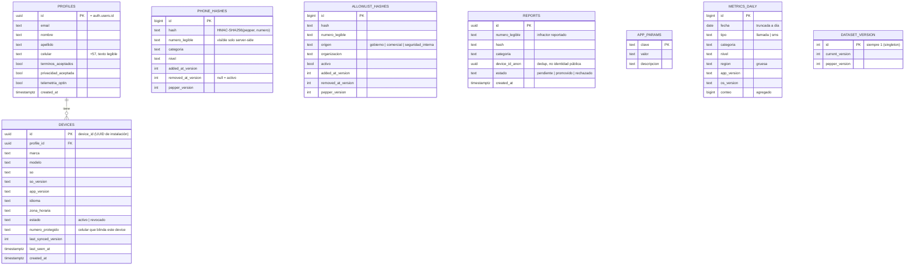
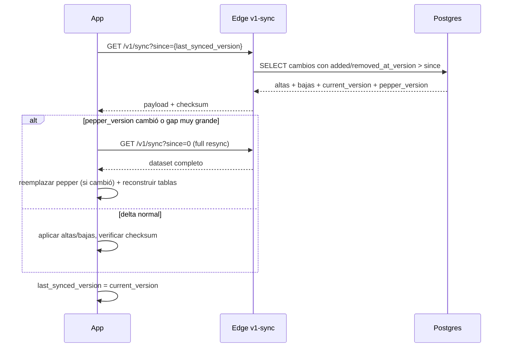
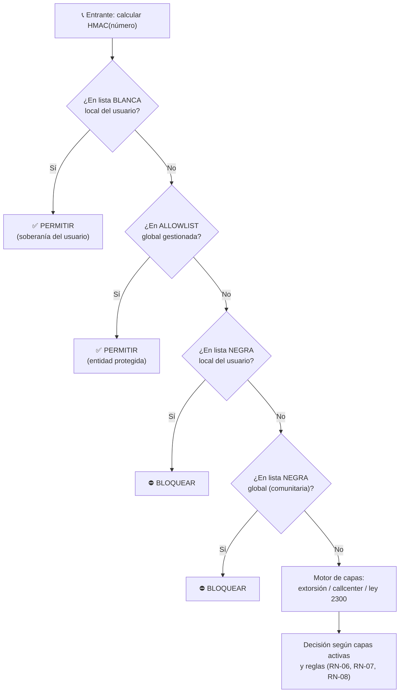
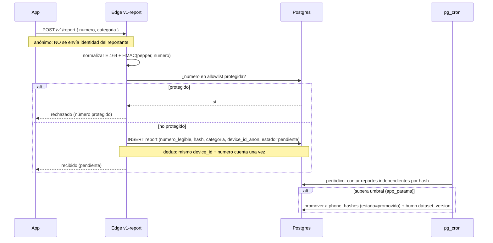

# 03 · Modelo de datos y sincronización

Define el esquema de Supabase, el dataset de bloqueo que se distribuye a los dispositivos, el delta sync versionado, la jerarquía de precedencia que gobierna cada decisión de bloqueo, y los flujos de reportes y allowlists.

---

## 03.1 Esquema de datos en Supabase (Postgres)

### Notas sobre las tablas

- **`profiles`** extiende `auth.users` (Supabase Auth es la fuente de identidad). El `celular` se guarda **legible** (necesario para cuenta, exclusividad por número y OTP futuro).
- **`devices`**: `id` es el **UUID de instalación propio** [DA-02], no PII de hardware. `numero_protegido` ancla la exclusividad [DA-03]. `estado` + `last_synced_version` gobiernan revocación y delta.
- **`phone_hashes`**: `numero_legible` existe **solo server-side**; a los dispositivos **solo** se les envía `hash`. `added_at_version`/`removed_at_version` habilitan el delta [DA-08].
- **`allowlist_hashes`**: alimentada por el **proyecto de administración externo** (CSV/manual). Este sistema solo la lee y distribuye.
- **`reports`**: guarda `numero_legible` del **infractor** (no del reportante) + `device_id_anon` para dedup. Anónimo respecto al reportante [DA-10].
- **`app_params`**: umbral de reportes, ventanas, constantes de tiempo ahorrado, etc. Ajustables sin desplegar.
- **`metrics_daily`**: Plano A — agregado, sin identidad [DA-01].
- **`dataset_version`**: singleton con el contador global y la versión de pepper vigente.

---

## 03.2 Row Level Security (RLS)

RLS es la línea de defensa principal de acceso por fila [DA-11]. Reglas base:

| Tabla | Lectura | Escritura |
|-------|---------|-----------|
| `profiles` | solo el propio `id` | solo el propio `id` (campos permitidos) |
| `devices` | solo dispositivos del propio `profile_id` | vía Edge Function (registro/revocación) |
| `phone_hashes` / `allowlist_hashes` | **nunca** directo por el cliente | solo service role (Edge / admin) |
| `reports` | **nunca** lectura pública | inserción vía Edge Function |
| `app_params` | solo lectura de claves públicas marcadas | solo service role |
| `metrics_daily` | **nunca** por el cliente | inserción agregada vía Edge Function |

> El cliente **no** consulta tablas sensibles por la API REST de Supabase. Hashes, reportes y métricas pasan **siempre** por Edge Functions. Lo único que el cliente puede leer directo por RLS es su propio perfil y sus propios dispositivos.

---

## 03.3 Dataset de bloqueo distribuido [DA-06]

El dataset que descarga el dispositivo tiene **secciones versionadas**:

| Sección | Contenido | Estado MVP |
|---------|-----------|:---:|
| `phone_hashes` | HMAC de números E.164 + códigos cortos SMS | ✅ activo |
| `allowlist_hashes` | HMAC de números protegidos (gobierno/empresas/seguridad) | ✅ activo (lectura; se alimenta externo) |
| `domain_hashes` | HMAC de dominios/URLs maliciosas en SMS | 🟡 estructura lista, matching diferido |
| `content_rules` | reglas/keywords de contenido difuso | ❌ fase futura |

El esquema del dataset y del delta ya contempla `domain_hashes` para no rehacer el sync cuando se active.

---

## 03.4 Delta sync versionado por secuencia [DA-08]

### Modelo

- `dataset_version.current_version`: contador global que **se incrementa con cada cambio** (alta o baja).
- Cada hash tiene `added_at_version` y `removed_at_version` (soft delete).
- El dispositivo guarda `last_synced_version`.

### Flujo

### Por qué por secuencia y no por fecha

- No depende de relojes sincronizados entre dispositivos (el prototipo ya tenía el problema del `timestamp` como string libre).
- Es **idempotente**: pedir el mismo `since` dos veces da el mismo resultado y aplicarlo es seguro.
- Soft delete permite propagar **bajas** (un número que dejó de ser peligroso o fue a la allowlist).

### Activación del sync [DA-08]

- **Background diario:** WorkManager (Android). BGTaskScheduler (iOS, fase futura, con sus límites).
- **Oportunista:** al abrir la app y al recuperar conexión de red.
- La renovación de sesión (cada 12h) garantiza al menos un contacto diario con el servidor.

---

## 03.5 Jerarquía de precedencia de bloqueo [DA-09]

El corazón del motor de dominio. Para **cada** llamada/SMS entrante se evalúa en este orden y **gana el primero que coincide**:

| Nivel | Fuente | Acción | Dónde vive |
|:---:|--------|--------|-----------|
| 1 | Lista **blanca** local | siempre permite | SQLite local (no sincroniza) |
| 2 | **Allowlist** global gestionada | siempre permite | dataset descargado |
| 3 | Lista **negra** local | siempre bloquea | SQLite local (no sincroniza) |
| 4 | Lista **negra** global | bloquea | dataset descargado |
| 5 | Motor de capas | evalúa escudo | config local + reglas |

**Reglas clave:**
- El **usuario es soberano** sobre su teléfono (nivel 1 por encima de todo).
- Una **entidad protegida** (nivel 2) no puede ser bloqueada ni por reportes maliciosos ni por la lista comunitaria.
- Listas locales (niveles 1 y 3) **nunca se sincronizan** al servidor (privacidad).

---

## 03.6 Reporte comunitario con moderación [DA-10]

**Garantías:**
- El reporte **nunca** entra directo al blacklist global; requiere **N reportes independientes** (N en `app_params`).
- **Dedup** por `device_id_anon`: un mismo dispositivo reportando el mismo número cuenta una vez.
- **Allowlist de protección** bloquea el envenenamiento de números legítimos (bancos, emergencias, entidades).
- El servidor guarda el **número legible del infractor** para moderación/auditoría, manteniendo anonimato del reportante.

---

## 03.7 Allowlists gestionadas por organización

- Modeladas en `allowlist_hashes` con `origen` y `organizacion`.
- **Alimentadas por el proyecto de administración web externo** (CSV/manual); este sistema **no** construye esa gestión ni el billing.
- `activo = false` (p. ej. una empresa dejó de pagar) → la fila sale del próximo delta → esos números vuelven a evaluarse normal.
- Se distribuyen a los dispositivos como la sección `allowlist_hashes` del dataset y se respetan en el **nivel 2** de la precedencia.

---

## 03.8 Normalización de números (RN-04)

- Móviles Colombia → **E.164**: `+57` + 10 dígitos (que inician en 3).
- Se normaliza **antes** de hashear, comparar o deduplicar (en servidor y en dispositivo, idéntico, para que los HMAC coincidan).
- **Códigos cortos SMS** (p. ej. `890123`): categoría aparte, sin normalización E.164, hasheados tal cual.
- Esto corrige la deuda del prototipo (comparaba strings exactos: `+57 300…` ≠ `300…`).
