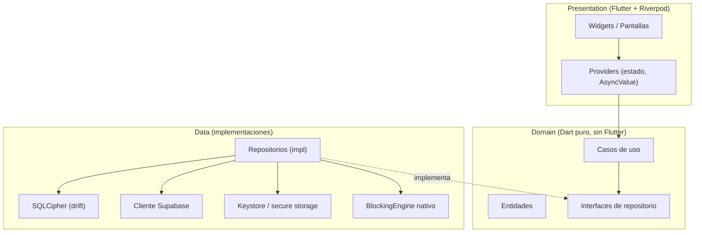
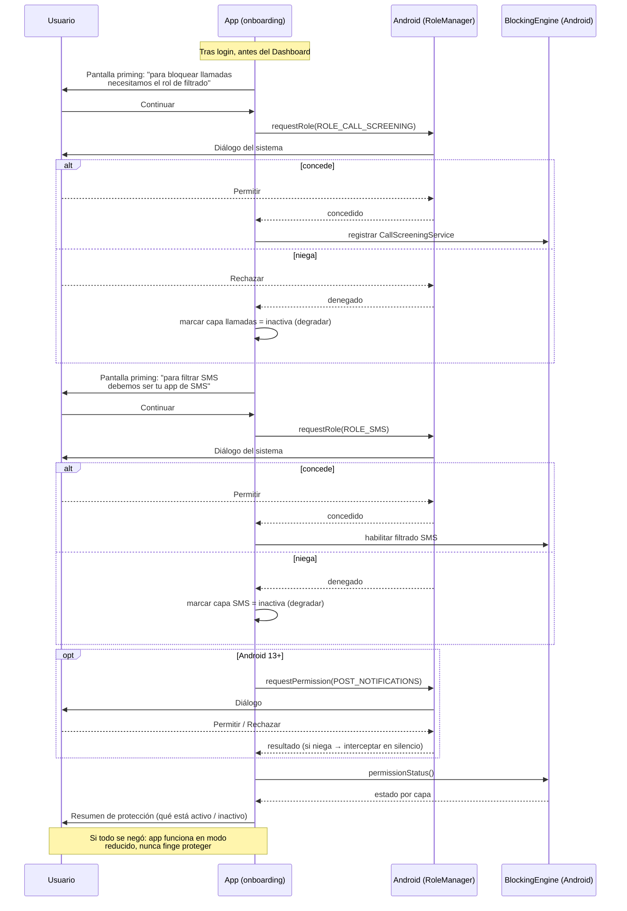
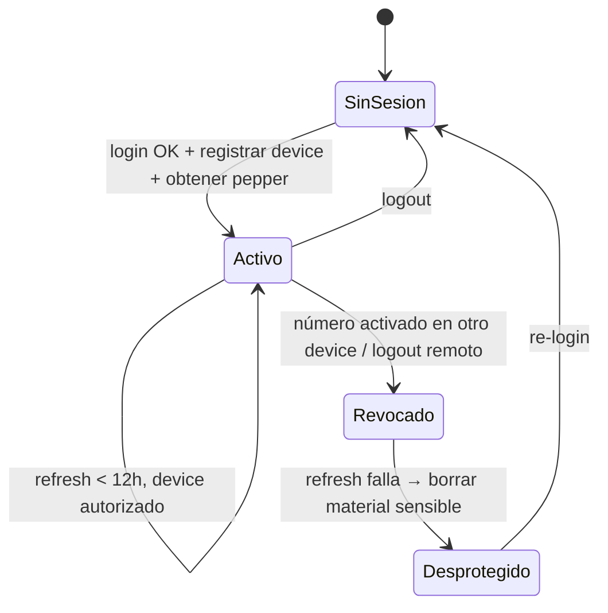

# 04 · Aplicación Flutter

Arquitectura interna de la app: capas, organización por features, gestión de estado, persistencia, la capa nativa de interceptación y los flujos de sesión/sync.

---

## 04.1 Clean Architecture por features [DA-13]

Tres capas, dependencias apuntando hacia el dominio (regla de dependencia):



- **Domain** no conoce Flutter ni Supabase ni SQLite. Contiene la lógica de negocio pura: entidades, casos de uso y el **motor de precedencia de 5 niveles**.
- **Data** implementa las interfaces del dominio con tecnologías concretas.
- **Presentation** solo habla con casos de uso vía providers.

---

## 04.2 Organización por features

Estructura que mapea 1:1 con la documentación de negocio (`02-business`), para trazabilidad directa doc ↔ código:

```
app/lib/
├── core/
│   ├── crypto/            # HMAC, verificación de checksum
│   ├── db/               # drift + SQLCipher, migraciones
│   ├── secure/           # acceso a keystore (pepper, DEK, tokens)
│   ├── network/          # cliente Supabase, pinning, interceptores /v1
│   ├── error/            # tipos de error, Result/Either
│   └── platform/         # BlockingEngine (interfaz + channel)
├── features/
│   ├── auth/             # 01-autenticacion
│   ├── shield/           # 02-escudo-dashboard (3 capas, estado agregado)
│   ├── events/           # 03-registro / 04-detalle de evento
│   ├── lists/            # 05-listas (blanca/negra local)
│   ├── reports/          # 06-canales-denuncia + reporte comunitario
│   ├── simulator/        # 07-simulador
│   ├── sync/             # delta sync, background, integridad del dataset
│   └── metrics/          # Plano B local + envío agregado Plano A
├── shell/                # 08-navegacion-y-shell (guard de auth, bottom nav)
└── main.dart             # flavors / arranque
```

Cada feature contiene sus subcarpetas `presentation/`, `domain/`, `data/`.

---

## 04.3 Gestión de estado — Riverpod [DA-13]

- **Riverpod** por testabilidad, inyección de dependencias integrada y manejo natural de async.
- Los cuatro estados obligatorios del dominio (`cargando / éxito / error / vacío`, ver `00-modelo-dominio` §00.5) se modelan con **`AsyncValue<T>`** más un estado "vacío" explícito donde aplique (p. ej. listas sin elementos, historial de usuario nuevo).
- Esto corrige la deuda del prototipo, que solo implementaba `cargando → éxito` y carecía de `error`/`vacío` reales.

```dart
// Ejemplo conceptual de estado de una lista de eventos
final eventsProvider = AsyncNotifierProvider<EventsNotifier, List<EventoInterceptado>>(...);

// En UI:
events.when(
  loading: () => const SkeletonList(),
  error:   (e, _) => ErrorRetry(onRetry: ...),
  data:    (items) => items.isEmpty ? const EmptyState() : EventList(items),
);
```

---

## 04.4 Persistencia local — drift + SQLCipher [DA-07]

- **drift** da ORM tipado, migraciones versionadas y queries en Dart con seguridad de tipos.
- Montado sobre **SQLCipher** (AES-256) con la **DEK** del keystore.
- Tablas locales: hashes descargados, listas locales, config del escudo, historial de eventos, contadores de métricas.
- Para el volumen esperado (miles de hashes), la lista cabe en memoria como `Set` para matching **O(1)**; la SQLite es la persistencia, el `Set` es el índice de runtime.

---

## 04.5 Capa nativa de interceptación — `BlockingEngine`

Interfaz Dart que aísla lo específico de plataforma [DA-12]:

```dart
abstract class BlockingEngine {
  Future<bool> requestPermissions();        // roles de call screening / SMS
  Future<PermissionStatus> permissionStatus();
  Stream<IncomingContact> get incoming;      // llamada/SMS entrante
  Future<void> decide(ContactId id, Decision decision); // permitir/bloquear
}
```

- **Android (MVP):** implementación con `CallScreeningService` + rol de call screening, y rol de app SMS por defecto. Recibe el entrante, la app evalúa con el motor de precedencia, responde permitir/bloquear.
- **iOS (futuro):** implementación que empuja la lista de hashes a una **Call Directory Extension** y una **Message Filter Extension**; sin motor dinámico en tiempo real.

El flujo entre nativo y Dart va por **platform channels**. El dominio no sabe en qué plataforma corre.

### Degradación por permisos (RN del dominio §00.6)

- Solicitud de roles en **onboarding**.
- Si se niega un rol → pantalla de "permiso denegado" con enlace a ajustes del SO, y **degradación**: la app comunica con transparencia qué capa de protección está inactiva (no finge estar protegiendo).

### Onboarding de permisos en Android

Android exige **roles** (no simples permisos runtime) para interceptar. Son concesiones fuertes que el usuario otorga vía diálogos del sistema (`RoleManager`), y pueden revocarse en ajustes en cualquier momento. El onboarding los solicita en orden, explicando cada uno **antes** de lanzar el diálogo del SO (pantalla de "pre-permiso" o *priming*), y degrada con transparencia si alguno se niega.

| Rol / permiso | API Android | Para qué | Si se niega |
|---------------|-------------|----------|-------------|
| **Call Screening** | `ROLE_CALL_SCREENING` (`RoleManager`) + `CallScreeningService` | Interceptar y rechazar/silenciar llamadas | Capa de llamadas inactiva; avisar y ofrecer reintento |
| **App SMS por defecto** | `ROLE_SMS` (`RoleManager`) | Filtrar SMS entrantes | Capa de SMS inactiva; avisar y ofrecer reintento |
| **Notificaciones** | `POST_NOTIFICATIONS` (Android 13+) | Mostrar heads-up de interceptación | Interceptar en silencio, sin notificar |
| **Teléfono (marcar)** | `tel:` (sin permiso explícito) | Llamar al GAULA 165 | Mostrar el número para marcar manualmente |
| **Contactos** | — | **No se solicita a propósito** (RN-01) | N/A |



**Reglas del flujo:**
- **Priming antes del diálogo del SO:** cada rol se explica en una pantalla propia antes de invocar `RoleManager`, para que el usuario entienda por qué (mejora la tasa de concesión y es buena práctica de UX/seguridad).
- **Degradación honesta:** si un rol se niega, la capa correspondiente queda inactiva y el estado del escudo (RN-03) lo refleja — la app **no simula** estar protegiendo.
- **Re-solicitud:** desde la pantalla de estado y desde ajustes de la app, el usuario puede reintentar conceder un rol (enlace directo a los ajustes del SO si el diálogo ya no se puede volver a mostrar).
- **Revocación externa:** si el usuario quita un rol desde ajustes de Android, `permissionStatus()` lo detecta al reanudar la app y actualiza el estado del escudo.

---

## 04.6 Sesión del dispositivo y revocación [DA-03, DA-04]



- **Access token: 12h.** Al renovar, la Edge Function `v1-session` verifica que el `device_id` siga `activo` en la tabla `devices`.
- Si el número protegido se activó en otro dispositivo [DA-03], este queda `revocado`; el próximo refresh **falla** → la app **borra el material sensible local** (pepper, DEK, hashes) y cae a **desprotegido**.
- Ventana máxima de doble protección: **12h**. No se usa push.
- El refresh token válido evita que el usuario re-teclee contraseña cada 12h, pero un dispositivo revocado **no puede** renovar.

### Flujo de exclusividad por número (advertencia)

```mermaid
sequenceDiagram
    participant B as Dispositivo B (nuevo)
    participant Edge as Edge v1-session
    participant PG as devices

    B->>Edge: activar protección para numero_protegido
    Edge->>PG: ¿numero_protegido activo en otro device?
    PG-->>Edge: sí (device A)
    Edge-->>B: advertencia: "ya protegido en otro dispositivo;<br/>si continúas, aquel quedará desprotegido"
    B->>Edge: confirmar
    Edge->>PG: marcar A = revocado, B = activo
    Note over PG: A caerá a desprotegido en su próximo refresh (≤12h)
```

---

## 04.7 Sincronización desde la app [DA-08]

- **`features/sync`** orquesta: background diario (WorkManager), oportunista al abrir y al recuperar red.
- Verifica **integridad** del dataset (checksum/firma) antes de aplicar.
- Maneja **full resync** si cambió `pepper_version` o el gap es grande.
- Actualiza `last_synced_version` y el `Set` en memoria para el matching.

---

## 04.8 Métricas desde la app [DA-01]

- **Plano B (local):** contadores en SQLite; la UI calcula "tu tiempo ahorrado" con las constantes (`app_params`) sin que nada salga.
- **Plano A (agregado, opt-in):** si el usuario aceptó telemetría, `features/metrics` envía **lotes agregados diarios** (conteos por tipo/categoría/nivel/día/región gruesa) a `v1-metrics`. Nunca número, contenido, `user_id` ni `device_id`.

---

## 04.9 Chrome del prototipo a eliminar

El prototipo React (`app_desing/`) incluye toolbar de salto entre pantallas, marco emulador y datos mock. **Nada de eso se porta.** La app Flutter arranca en `login` con guard de autenticación (DN-02), sin modo invitado, con datos reales persistidos.
