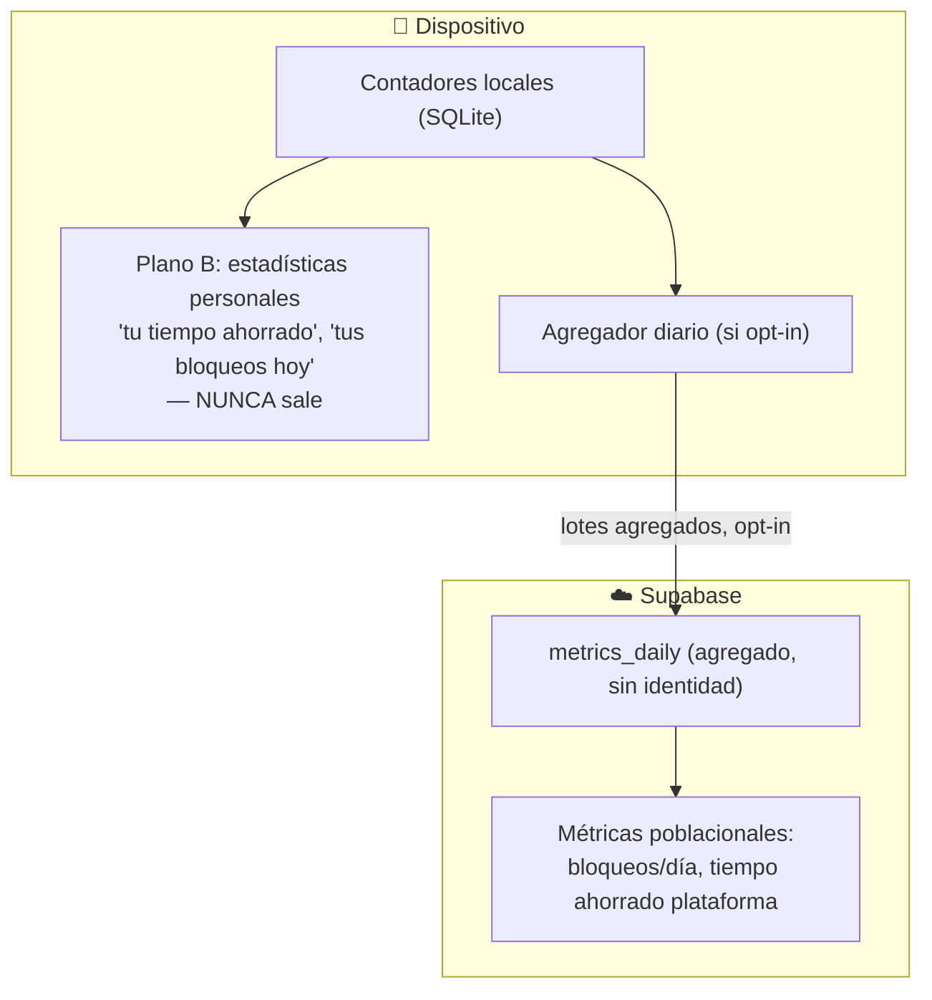

# 05 · Backend, API y métricas

Define el backend sobre Supabase, los contratos de las Edge Functions (API versionada `/v1`), el modelo de métricas en dos planos y las garantías de privacidad.

---

## 05.1 Topología del backend [DA-11]

| Pieza | Rol |
|-------|-----|
| **Supabase Auth** | Identidad: registro, login, sesión, refresh, recuperación por email. |
| **Edge Functions (Deno/TS)** | **Toda** la lógica de negocio y criptográfica. Única frontera que toca el pepper. |
| **Postgres + RLS** | Verdad de datos; RLS protege acceso por fila (no contiene lógica de negocio). |
| **pg_cron** | Promoción de reportes, recálculo de `dataset_version`, retención/limpieza. |
| **Vault** | Pepper y secretos. |

**Regla:** sin RPC de Postgres por ahora. El cliente no toca tablas sensibles directamente; pasa por Edge Functions. RLS es defensa en profundidad, no la vía de negocio.

---

## 05.2 API versionada `/v1` [DA-15]

Todas las funciones viven bajo un prefijo de versión y como **carpetas independientes** en el repo, para que varias versiones coexistan en `main`.

```
supabase/functions/
├── v1-session/     # validar/renovar sesión contra tabla devices; registrar/revocar device
├── v1-pepper/      # entregar el pepper al device autenticado (lee Vault)
├── v1-sync/        # delta sync del dataset de hashes
├── v1-report/      # ingesta de reporte comunitario (anónimo)
└── v1-metrics/     # ingesta de métricas agregadas (opt-in)
```

### Contratos (resumen)

#### `POST /v1/session/register-device`
Registra o actualiza un dispositivo de la cuenta.
```jsonc
// request
{ "device_id": "uuid", "marca": "...", "modelo": "...", "so": "android",
  "so_version": "14", "app_version": "1.0.0", "idioma": "es-CO", "zona_horaria": "America/Bogota",
  "numero_protegido": "+573001234567" }
// response
{ "estado": "activo", "warning": null }
// si el número ya está protegido en otro device:
{ "estado": "pendiente_confirmacion", "warning": "numero_protegido_en_otro_dispositivo" }
```

#### `POST /v1/session/activate` (confirmar exclusividad)
Confirma la toma de protección; revoca el dispositivo anterior [DA-03].
```jsonc
{ "device_id": "uuid", "confirmar_revocacion": true }
// response: { "estado": "activo", "revocado": "device_id_anterior" }
```

#### `POST /v1/session/refresh`
Renueva la sesión (12h) verificando que el dispositivo siga autorizado [DA-04].
```jsonc
// response OK: { "access_token": "...", "expires_in": 43200 }
// si revocado: 401 { "error": "device_revocado" }  → la app borra material sensible
```

#### `GET /v1/pepper`
Entrega el pepper al dispositivo autenticado [DA-05]. Requiere sesión válida + dispositivo activo.
```jsonc
{ "pepper": "base64...", "pepper_version": 3 }
```

#### `GET /v1/sync?since={version}`
Delta sync del dataset [DA-08].
```jsonc
{
  "current_version": 1540,
  "pepper_version": 3,
  "altas": {
    "phone_hashes": [ { "hash": "...", "categoria": "extorsion", "nivel": "ALTO" } ],
    "allowlist_hashes": [ { "hash": "...", "origen": "gobierno" } ]
  },
  "bajas": { "phone_hashes": ["hash1","hash2"], "allowlist_hashes": [] },
  "checksum": "sha256:...",
  "full": false
}
```
Si `pepper_version` del cliente difiere o el gap es grande → el cliente pide `since=0` (full).

#### `POST /v1/report`
Reporte comunitario anónimo [DA-10].
```jsonc
// request (NO incluye identidad del reportante)
{ "numero": "+573001112233", "categoria": "extorsion", "device_id_anon": "uuid" }
// response: { "estado": "pendiente" }  |  { "estado": "rechazado", "motivo": "numero_protegido" }
```

#### `POST /v1/metrics`
Ingesta de métricas agregadas, solo si el usuario optó-in [DA-01].
```jsonc
{
  "lotes": [
    { "fecha": "2026-10-14", "tipo": "llamada", "categoria": "extorsion", "nivel": "ALTO",
      "region": "CO-BOG", "app_version": "1.0.0", "os_version": "14", "conteo": 12 }
  ]
}
// response: { "recibido": true }
```

### Forzar actualización de versiones obsoletas [DA-15]

Cada request lleva `app_version`. El servidor compara contra una política en `app_params`:
```jsonc
// respuesta común ante versión no soportada:
426 { "error": "upgrade_required", "min_version": "1.2.0" }
```
La app muestra pantalla de actualización obligatoria. Esto permite "matar" versiones con vulnerabilidades conocidas.

---

## 05.3 Métricas en dos planos [DA-01]



### Plano A — poblacional, anónimo, opt-in

Campos que viajan (y **solo** estos):

| Campo | Ejemplo | Nota |
|-------|---------|------|
| `tipo` | llamada / sms | |
| `categoria` | extorsion / phishing / callcenter / ley2300 | catálogo RN-07 |
| `nivel` | ALTO / MEDIO / BAJO | |
| `fecha` | 2026-10-14 | **truncada a día**, sin hora |
| `region` | CO-BOG | gruesa, sin lat/long |
| `app_version`, `os_version` | 1.0.0 / 14 | análisis técnico |
| `conteo` | 12 | agregado |

**Nunca:** número, contenido, `user_id`, `device_id`, ubicación precisa.
**Envío:** lotes agregados diarios (no eventos individuales), reduce correlación y costo.

### Plano B — personal, local

Se calcula en el dispositivo desde los contadores locales. "Tu tiempo ahorrado" usa constantes de `app_params`:
- Llamada bloqueada ≈ **90 s**.
- SMS bloqueado ≈ **15 s**.
- `tiempo_ahorrado = Σ (bloqueos_tipo × constante_tipo)`.

---

## 05.4 Catálogo de métricas (MVP vs. fase 2)

### MVP

| Métrica | Pregunta de negocio | Fuente |
|---------|---------------------|--------|
| Bloqueos por día / categoría / tipo / nivel | ¿Cuánto bloquea la plataforma y de qué? | Plano A |
| Tiempo ahorrado agregado | ¿Cuánto tiempo ahorramos? | Plano A + constantes |
| Dispositivos activos (DAU/MAU) | ¿Cuánta base activa hay? | heartbeats/refresh, sin PII |
| Frescura de sync (% sincronizados < 24/48h) | ¿Qué cobertura real de protección hay? | server |

### Fase 2

| Métrica | Pregunta | Nota |
|---------|----------|------|
| Salud comunitaria (reportes/día, % promovidos) | ¿La comunidad aporta? | derivada de `reports` |
| Cobertura global vs. local | ¿La inteligencia global sirve o la gente bloquea sola? | agregada |
| % escudo total/parcial/desactivado | ¿Salud del escudo? | Plano A, usa RN-03 |
| Opt-in rate de telemetría | ¿Cuántos comparten? | server |
| **Falsos positivos (contador agregado)** | ¿Hay hashes globales que la gente "rescata"? | contador anónimo opt-in: "N desbloqueos de hash global/día", **nunca el número** |

> La métrica de falsos positivos es una señal valiosa para moderación. Se enviará **solo como contador agregado anónimo**, bajo el mismo opt-in, sin revelar el número ni el hash.

---

## 05.5 Parámetros configurables (`app_params`)

Ajustables sin desplegar [DA-10, DA-01]:

| Clave | Propósito |
|-------|-----------|
| `report_threshold_n` | N reportes independientes para promover a blacklist. |
| `report_window` | Ventana temporal del conteo de reportes. |
| `time_saved_call_seconds` | Constante tiempo ahorrado por llamada (≈90). |
| `time_saved_sms_seconds` | Constante tiempo ahorrado por SMS (≈15). |
| `min_app_version` | Versión mínima soportada (forzar actualización). |
| `sync_full_gap` | Gap de versión a partir del cual se exige full resync. |

Secretos (pepper) → **Vault**, nunca en `app_params`.

---

## 05.6 Privacidad y cumplimiento (resumen operativo)

- Telemetría **opt-in**; negarla **no** degrada la protección.
- Datos de terceros (quién te contacta/escribe) **no salen** nunca.
- Reporte comunitario anónimo respecto al reportante; el servidor ve el número del **infractor**, no del denunciante.
- Alineado con Ley 1581 (Habeas Data CO) y buenas prácticas tipo GDPR (minimización, consentimiento, anonimización). Detalle en [02 · Seguridad](./02-seguridad-y-criptografia.md) §02.7.
