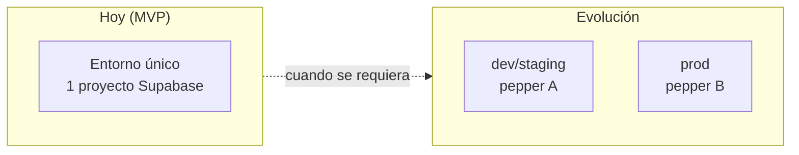
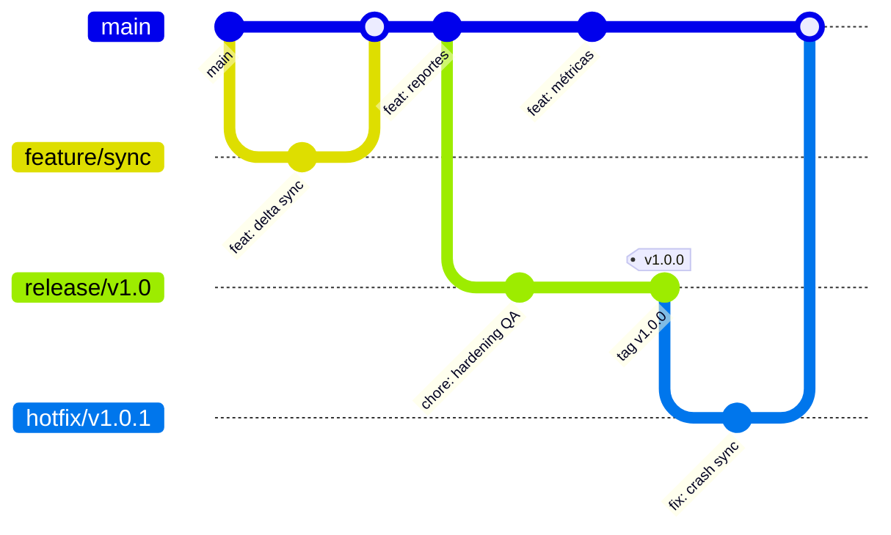
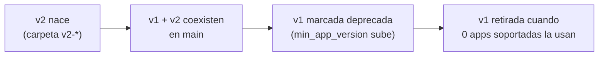

# 06 · Entornos, branching y versionado

Define cómo se organiza el monorepo, la estrategia de ramas, el versionado semántico y cómo conviven múltiples versiones de la API.

---

## 06.1 Monorepo [DA-15]

Todo vive en un solo repositorio:

```
shield-co-vip/
├── 01-docs/            # especificación funcional
├── 02-business/        # reglas de negocio por capacidad
├── 03-architecture/    # este bloque
├── app_desing/         # prototipo React de referencia (NO productivo)
├── app/                # App Flutter (Android-first)
└── supabase/
    ├── migrations/     # migraciones SQL versionadas (CLI de Supabase)
    └── functions/      # Edge Functions por versión de API (v1-*)
```

- **Migraciones** se gestionan con la CLI de Supabase (SQL en el repo), **nunca** cambios manuales en el panel: reproducibilidad y trazabilidad.
- La app y el backend versionan a **ritmos distintos** pero conviven en el mismo historial.

---

## 06.2 Entornos [DA-15]

- **Ahora:** un solo entorno. Suficiente para el MVP.
- **Evolución documentada:** dos proyectos Supabase (dev/staging + prod), peppers y secretos **distintos por entorno**, y **flavors** de Flutter (`dev`, `prod`) apuntando a cada backend.



> **Importante:** no compartir nunca la misma DB entre entornos cuando se separen, y usar peppers independientes (una fuga en dev no debe comprometer prod).

---

## 06.3 Estrategia de branching — trunk-based [DA-16]



| Rama | Propósito | Vida |
|------|-----------|------|
| `main` | Troncal estable, siempre desplegable. Todo integra aquí vía PR. | permanente |
| `feature/*` | Una funcionalidad; sale de `main`, vuelve por PR con review. | corta (días) |
| `release/vX.Y` | Estabilizar/QA una versión mientras `main` sigue avanzando. Se taggea al publicar. | por release |
| `hotfix/*` | Corrección urgente de producción; sale del tag afectado, se taggea patch, se mergea a `main`. | puntual |

- **Sin `develop`:** trunk-based directo, apoyado en **feature flags** cuando algo entra incompleto.
- **Conventional Commits:** habilita changelog y bump automático de SemVer.
- **Tags `vX.Y.Z` (SemVer):** cada release publicado es inmutable y trazable.

---

## 06.4 Versionado de la API y compatibilidad [DA-15, DA-16]

Esta es la regla clave que conecta ramas, versiones de app y versiones de API.

### Principios

1. **API versionada por carpeta, no por rama.** `v1-sync`, `v2-sync` coexisten en `main` como carpetas separadas. Nunca se borra una versión en uso.
2. **Compatibilidad hacia atrás obligatoria.** `main` debe servir **todas** las versiones de API que tengan apps vivas usándolas.
3. **Deprecación ordenada.** Una versión de API solo se retira cuando **ninguna versión de app soportada** la consume.

### Matriz de soporte (ejemplo)

| Versión de app | Habla con API | Estado |
|:---:|:---:|:---:|
| 1.0.x | `/v1` | soportada |
| 1.1.x | `/v1` | soportada |
| 2.0.x | `/v2` | soportada |
| < 1.0 | — | forzar actualización (426) |

- **Política sugerida:** soportar las últimas **2 minor** de API. Apps por debajo del `min_app_version` (en `app_params`) reciben `426 upgrade_required` [DA-15].
- La sesión de 12h + forzado de actualización dan control para deprecar versiones viejas de forma predecible.

### Ciclo de vida de una versión de API



---

## 06.5 Versionado del dataset y del pepper

Independiente del versionado de API y de app (ya detallado en docs 02 y 03):

- **`dataset_version`**: secuencia incremental para el delta sync [DA-08].
- **`pepper_version`**: si cambia, fuerza full-resync y reemplazo del pepper en keystore [DA-05].

Estos tres ejes (API, dataset, pepper) versionan **por separado** y cada uno tiene su mecanismo de compatibilidad.

---

## 06.6 CI/CD (recomendación, fase posterior)

No bloqueante para el MVP, pero recomendado:

- **Flutter:** análisis estático + tests + build de APK/AAB por flavor.
- **Supabase:** `supabase db push` (migraciones) + `supabase functions deploy` por versión.
- **Gate de PR a `main`:** lint, tests, chequeo de que no se rompe compatibilidad de API.
- **Release:** tag SemVer dispara build firmado + deploy de funciones/migraciones.

---

## 06.7 Resumen de ejes de versionado

| Eje | Mecanismo | Qué fuerza al cambiar |
|-----|-----------|-----------------------|
| **App** | SemVer `vX.Y.Z` + tags | nada automático; `min_app_version` puede forzar update |
| **API** | carpetas `/vN` en `main` | coexistencia; deprecación por matriz de soporte |
| **Dataset** | `dataset_version` incremental | delta sync normal |
| **Pepper** | `pepper_version` | full-resync + reemplazo de pepper |
| **DB** | migraciones CLI versionadas | aplicar en orden, reproducible |
