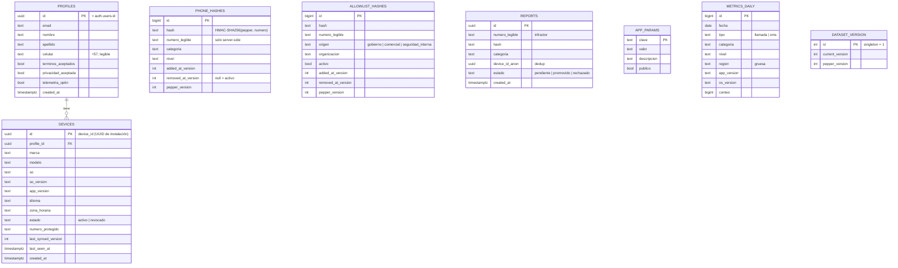

# Esquema completo (referencia · fases 1–4)

ERD íntegro del backend según [`03-architecture/03-datos-y-sincronizacion.md`](../../03-architecture/03-datos-y-sincronizacion.md) §03.1. Sirve de guía para las fases futuras. **Hoy solo existen físicamente** `profiles` y `app_params` (Fase 1); el resto está diseñado pero no migrado.

| Tabla | Fase | ¿Existe hoy? |
|-------|:---:|:---:|
| `profiles` | 1 | ✅ |
| `app_params` | 1 | ✅ |
| `devices` | 2 | ❌ |
| `dataset_version` | 3 | ❌ |
| `phone_hashes` | 3 | ❌ |
| `allowlist_hashes` | 3 | ❌ |
| `reports` | 4 | ❌ |
| `metrics_daily` | 4 | ❌ |

---

## ERD

## Notas por fase

- **Fase 2 · `devices`:** `id` = UUID de instalación [DA-02], `numero_protegido` ancla la exclusividad [DA-03], `estado` + `last_synced_version` gobiernan revocación y delta. RLS: el usuario lee solo sus dispositivos; la escritura pasa por Edge Function.
- **Fase 3 · dataset + cripto:** `phone_hashes`/`allowlist_hashes` nunca se leen directo por el cliente (solo service role / Edge). `numero_legible` vive solo server-side; al dispositivo solo va `hash`. Pepper en Vault, entregado por `v1-pepper` [DA-05]. `dataset_version` singleton para delta sync [DA-08].
- **Fase 4 · comunidad + métricas:** `reports` guarda el número del infractor y `device_id_anon` para dedup, anónimo respecto al reportante [DA-10]. `metrics_daily` es Plano A: agregado, sin identidad [DA-01]. `pg_cron` promueve reportes y recalcula versiones.

> Las decisiones que fijan estos diseños están en `03-architecture` (DA-01..DA-16). No duplicar aquí la justificación; este documento es solo el mapa del esquema.
